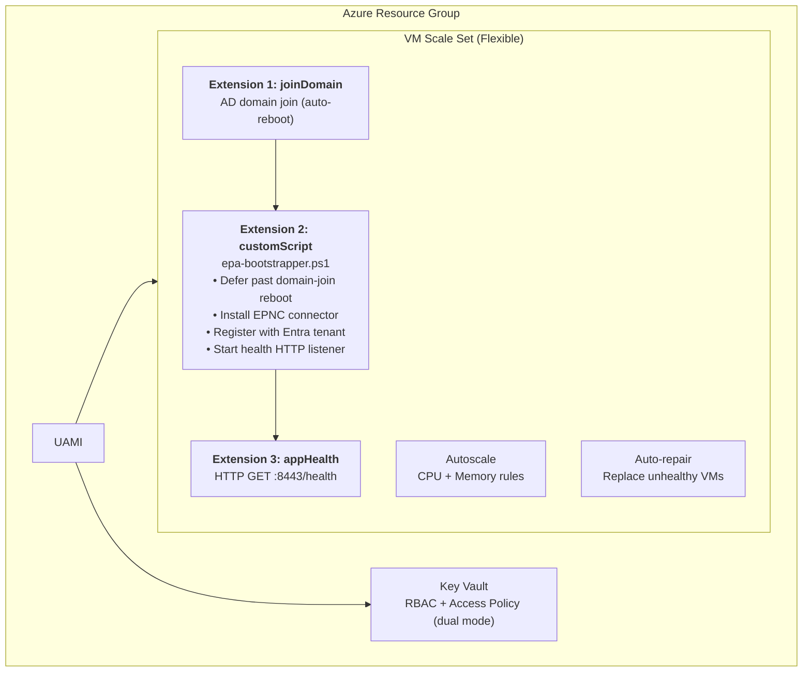

# Entra Private Access Connector -- VMSS Deployment

Deploy a fully automated Azure VM Scale Set whose instances automatically join an Active Directory domain, install and register the **Microsoft Entra Private Network Connector (EPNC)**, and report health -- all hands-off after the initial deployment.

## What This Does

This Bicep template provisions:

1. **A User Assigned Managed Identity (UAMI)** -- created (or updated) automatically with Key Vault access granted via both RBAC role assignment **and** classic access policy (works regardless of which permission model the Key Vault uses).
2. **A Flexible VM Scale Set** running Windows Server 2025 (configurable) with three VM extensions chained in order:
   - **JsonADDomainExtension** (v1.3) -- joins each instance to your AD domain (credentials encrypted in `protectedSettings`).
   - **CustomScriptExtension** (v1.10) -- downloads and runs `epa-bootstrapper.ps1`, which installs the EPNC connector and registers it with your Entra tenant.
   - **ApplicationHealthWindows** (v2.0, Rich Health States) -- probes an HTTP endpoint on each instance that checks the actual `WAPCSvc` Windows service.
3. **CPU + memory autoscaling** with a daily maintenance window (scale out on high CPU or low memory, scale in when idle, fixed instance count during a nightly 30-minute window).
4. **Automatic instance repair** -- unhealthy VMs (WAPCSvc not running) are replaced after a 30-minute grace period.

No secrets are stored in tags, visible extension settings, or deployment outputs.

---

## Architecture



---

## Prerequisites

### 1. Active Directory

- A domain controller reachable from the VMSS subnet.
- A **service account** (e.g. `svc-domainjoin@corp.contoso.com`) with permission to join computers to the domain (and optionally to a specific OU).

### 2. Azure Key Vault

You need a Key Vault with **four secrets**:

| Secret Name (default)     | Contents                                     |
|---------------------------|----------------------------------------------|
| `vmss-adminPassword`      | Local administrator password for VMSS VMs    |
| `domainJoin-password`     | Password for the AD domain join account      |
| `epaReg-username`         | Entra registration username (UPN)            |
| `epaReg-password`         | Entra registration password                  |

The registration credentials (`epaReg-*`) are for an Entra account that has permission to register Private Network Connectors. This is typically a Global Administrator or an account with the Application Administrator role.

> **Important:** The registration account must **not** require multi-factor authentication (MFA) or interactive conditional access policies. The connector registration runs unattended on each VMSS instance using the `Credentials` auth mode, which cannot satisfy interactive MFA prompts. If your tenant enforces MFA broadly, create a conditional access exclusion for this service account (scoped to the Private Network Connector registration action) or use a dedicated account with MFA disabled.

**Enable template deployment** on the Key Vault so Bicep can resolve `az.getSecret()` references at deployment time:

```bash
az keyvault update --name <your-vault> --enabled-for-template-deployment true
```

### 3. Networking

- An existing **Virtual Network** and **subnet** that has connectivity to your AD domain controllers and outbound internet access (for downloading the EPNC installer and reaching Microsoft services).
- Outbound **TCP 443** from the subnet to the endpoints below. If egress passes through an NSG, Azure Firewall, or NVA, allow these explicitly. Prefer service tags or FQDN rules over IPs -- the addresses behind these names rotate.

  | Endpoint | Service tag | Used for |
  |----------|-------------|----------|
  | `login.microsoftonline.com`, `login.windows.net`, `login.live.com` | `AzureActiveDirectory` | Connector registration (`AcquireToken`) and runtime token refresh |
  | `*.msappproxy.net` | -- | Installer download and connector traffic |
  | `*.servicebus.windows.net` | `ServiceBus` | Connector control channel |
  | `www.powershellgallery.com` | -- | Az.Accounts / Az.KeyVault download |
  | `<vault>.vault.azure.net` | `AzureKeyVault` | Registration credentials |
  | `crl*.digicert.com`, `ocsp.digicert.com`, `crl.microsoft.com`, `www.microsoft.com` | -- | Certificate revocation checks (**TCP 80**) |

  Managed identity tokens come from IMDS (`169.254.169.254`), which never leaves the host -- so a blocked `AzureActiveDirectory` path is not noticed until connector registration. See [Microsoft's connector network requirements](https://learn.microsoft.com/entra/global-secure-access/how-to-configure-connectors#network-requirements) for the authoritative list.

### 4. Deploying Principal Permissions

The identity running `az deployment group create` needs:

| Scope                          | Role                                            | Why                                                    |
|--------------------------------|-------------------------------------------------|--------------------------------------------------------|
| Target resource group          | Contributor                                     | Create VMSS, UAMI, autoscale setting                   |
| Key Vault resource group       | Owner _or_ User Access Administrator            | Create RBAC role assignment and access policy on Key Vault |
| Key Vault                      | Key Vault Secrets User                          | Resolve `az.getSecret()` at deployment time            |
| Storage account resource group | Owner _or_ User Access Administrator (optional) | Only if using `storageAccount` script source           |

---

## Quick Start

### Step 1: Create the Parameters File

Copy the sample and fill in your values:

```bash
cp epa-connector-vmss.sample.bicepparam epa-connector-vmss.bicepparam
```

Edit `epa-connector-vmss.bicepparam`:

```bicep
using 'epa-Connector-vmss.bicep'

// Key Vault coordinates -- fill in once, reused for secrets and params
var kvSubscriptionId = '<subscription-id>'
var kvResourceGroup  = '<resource-group>'
var kvName           = '<vault-name>'

// Secrets
param adminPassword      = az.getSecret(kvSubscriptionId, kvResourceGroup, kvName, 'vmss-adminPassword')
param domainJoinPassword = az.getSecret(kvSubscriptionId, kvResourceGroup, kvName, 'domainJoin-password')

// Networking
param vnetResourceGroupName = 'rg-networking'
param vnetName              = 'vnet-hub'
param subnetName            = 'snet-epac'

// AD Domain Join
param domainJoinFqdn     = 'corp.contoso.com'
param domainJoinOuPath   = 'OU=Servers,DC=corp,DC=contoso,DC=com'
param domainJoinUsername  = 'svc-domainjoin@corp.contoso.com'

// Key Vault & Registration -- reuse the vars above
param keyVaultName              = kvName
param keyVaultResourceGroupName = kvResourceGroup
```

> **Note:** The `var` declarations in `.bicepparam` files require **Bicep CLI 0.21.x or later**. The Key Vault coordinates are defined once and reused for both `az.getSecret()` calls and parameter values.

> **Important:** The `.bicepparam` file will contain your specific environment values. Add `*.bicepparam` (but not `*.sample.bicepparam`) to your `.gitignore` if you fork this repo.

### Step 2: Deploy

```bash
az deployment group create \
  --resource-group <your-resource-group> \
  --template-file epa-Connector-vmss.bicep \
  --parameters epa-connector-vmss.bicepparam
```

That's it. The deployment will:
1. Create (or update) the UAMI.
2. Grant the UAMI Key Vault access via both RBAC (`Key Vault Secrets User`) **and** classic access policy (`Secret → Get`), so it works regardless of which permission model your Key Vault uses (best-effort -- see note below).
3. Deploy the VMSS with all three extensions chained.
4. Configure CPU + memory autoscaling (with a daily maintenance window) and automatic instance repair.

Each new VM instance will automatically join the domain, install the connector, register with Entra, and start reporting health.

> **Note on Key Vault permissions:** The Bicep deployment automatically grants the UAMI access via **both** an RBAC role assignment (`Key Vault Secrets User`) **and** a classic access policy (`Secret → Get`). Whichever permission model your Key Vault uses, one of these takes effect (the other is silently ignored). However, these grants are best-effort and can fail silently if the deploying principal lacks `Owner` or `User Access Administrator` on the Key Vault resource group. Additionally, Azure RBAC assignments are eventually consistent and may take several minutes to propagate after deployment. The bootstrapper retries with exponential back-off (15 s initial delay, doubling up to 60 s, 10 attempts — covering roughly 8 minutes) to handle propagation delays, but if instances consistently fail with `Forbidden` errors on Key Vault access, verify that the UAMI has the **Secret → Get** permission on the vault. You can grant this manually:
>
> ```bash
> # Using RBAC (for Key Vaults in RBAC mode)
> az role assignment create \
>   --assignee-object-id <UAMI-principal-id> \
>   --assignee-principal-type ServicePrincipal \
>   --role "Key Vault Secrets User" \
>   --scope /subscriptions/<sub>/resourceGroups/<rg>/providers/Microsoft.KeyVault/vaults/<vault-name>
>
> # Using access policies (for Key Vaults in Vault access policy mode)
> az keyvault set-policy --name <vault-name> \
>   --object-id <UAMI-principal-id> \
>   --secret-permissions get
> ```

---

## Script Source Options

The bootstrapper script (`epa-bootstrapper.ps1`) can be downloaded from two sources:

### Option A: GitHub (default)

Best for community/dev use. The VMSS downloads the script directly from a public GitHub raw URL.

```bicep
param scriptSource = 'github'
// param scriptGitHubUrl = 'https://raw.githubusercontent.com/...'  // default points to this repo
```

### Option B: Azure Storage Account

Best for production and air-gapped environments. Upload `epa-bootstrapper.ps1` to a blob container, then configure:

```bicep
param scriptSource                       = 'storageAccount'
param scriptStorageBlobUri               = 'https://stbootstrap.blob.core.windows.net/scripts/epa-bootstrapper.ps1'
param scriptStorageAccountName           = 'stbootstrap'
// param scriptStorageAccountResourceGroupName = 'rg-bootstrap'  // if in a different RG
```

The deployment will automatically grant the UAMI `Storage Blob Data Reader` on the storage account. The CustomScriptExtension authenticates using the UAMI's managed identity -- no SAS tokens or storage keys needed.

---

## Parameter Reference

### Required Parameters

| Parameter              | Type     | Description                                           |
|------------------------|----------|-------------------------------------------------------|
| `adminPassword`        | secure   | Windows local admin password (use KV reference)       |
| `domainJoinFqdn`       | string   | AD domain FQDN (e.g. `corp.contoso.com`)              |
| `domainJoinUsername`    | string   | UPN or `DOMAIN\user` of the domain join account       |
| `domainJoinPassword`   | secure   | Domain join password (use KV reference)               |
| `vnetResourceGroupName`| string   | Resource group containing the Virtual Network         |
| `vnetName`             | string   | Name of the existing Virtual Network                  |
| `subnetName`           | string   | Name of the subnet within the VNet                    |
| `keyVaultName`         | string   | Name of the Key Vault holding registration secrets    |

### Optional Parameters

| Parameter                          | Type   | Default                                   | Description                                                       |
|------------------------------------|--------|-------------------------------------------|-------------------------------------------------------------------|
| `vmssName`                         | string | `vmss-epac`                               | Name of the VM Scale Set                                          |
| `winImageSku`                      | string | `2025-datacenter-azure-edition-core`      | Windows Server image SKU                                          |
| `adminUsername`                     | string | `azAdministrator`                         | Local admin username                                              |
| `vmSize`                           | string | `Standard_B2ms`                           | VM instance size                                                  |
| `uamiName`                         | string | `uami-entraprivateconnector`              | Name of the UAMI (created if it doesn't exist)                    |
| `domainJoinOuPath`                 | string | `''` (default Computers container)        | OU path for the computer account                                  |
| `keyVaultResourceGroupName`        | string | `''` (same as deployment RG)              | Resource group of the Key Vault                                   |
| `registrationUserSecretName`       | string | `epaReg-username`                         | KV secret name for EPNC registration username                     |
| `registrationPasswordSecretName`   | string | `epaReg-password`                         | KV secret name for EPNC registration password                     |
| `scriptSource`                     | string | `github`                                  | `github` or `storageAccount`                                      |
| `scriptGitHubUrl`                  | string | _(this repo's raw URL)_                   | Raw URL to `epa-bootstrapper.ps1`                                 |
| `scriptStorageBlobUri`             | string | `''`                                      | Blob URI when using storage account source                        |
| `scriptStorageAccountName`         | string | `''`                                      | Storage account name (for RBAC)                                   |
| `scriptStorageAccountResourceGroupName` | string | `''` (same as deployment RG)         | Resource group of the storage account                             |
| `connectorGroupName`               | string | `''`                                      | Connector group to assign (see note below)                        |
| `minInstanceCount`                 | int    | `2`                                       | Autoscale minimum instances (2+ for high availability)            |
| `maxInstanceCount`                 | int    | `10`                                      | Autoscale maximum instances                                       |
| `autoscaleTimeZone`                | string | `UTC`                                     | Windows time zone for the maintenance window (e.g. `Eastern Standard Time`) |
| `healthPort`                       | int    | `8443`                                    | Port for the health HTTP listener                                 |

---

## Updating Configuration After Deployment

All parameter values -- including Key Vault secret references -- are **resolved and baked into the VMSS model at deployment time**. They are not re-read dynamically when new instances scale out. This means:

- Changing a Key Vault secret value (e.g. rotating `domainJoin-password`) has **no effect** on the running VMSS until you redeploy.
- Changing a plain parameter value (e.g. `vmSize` or `domainJoinOuPath`) likewise requires a redeployment.

**Redeployment is non-destructive.** Simply re-run the same deployment command:

```bash
az deployment group create \
  --resource-group <your-resource-group> \
  --template-file epa-Connector-vmss.bicep \
  --parameters epa-connector-vmss.bicepparam
```

Bicep/ARM deployments are idempotent. The rolling upgrade policy will gradually update existing instances to match the new model -- healthy instances continue serving while others are updated. There is no need to tear down and recreate the VMSS.

> **Tip:** If you rotate the domain join or registration credentials, update the secrets in Key Vault first, then redeploy. New and updated instances will pick up the current secret values.

---

## Health Monitoring and Auto-Repair

Each VMSS instance runs a lightweight HTTP health listener on port 8443 (configurable). The listener checks the `WAPCSvc` Windows service (the EPNC connector service) and returns responses conforming to the Azure [Rich Health States](https://learn.microsoft.com/en-us/azure/virtual-machine-scale-sets/virtual-machine-scale-sets-health-extension?tabs=rest-api#rich-health-states) protocol (all responses are HTTP 200; health state is conveyed in the response body):

- **Healthy:** `{"ApplicationHealthState":"Healthy","service":"WAPCSvc","state":"Running"}` -- connector is running.
- **Unhealthy:** `{"ApplicationHealthState":"Unhealthy","service":"WAPCSvc","state":"..."}` -- connector is stopped or missing.

The `ApplicationHealthWindows` extension (v2.0, Rich Health States) probes this endpoint every 30 seconds. Newly created instances enter an **Initializing** state with a 10-minute grace period, requiring 2 consecutive healthy probes before being considered healthy. If an instance reports unhealthy for 30 minutes, the **automatic repair policy** replaces the VM entirely -- a fresh instance joins the domain, reinstalls the connector, and registers.

### Testing Health Locally

From within a VMSS instance:

```powershell
Invoke-RestMethod http://localhost:8443/health
```

---

## Autoscaling

The deployment creates three autoscale profiles:

### Default / Post-Maintenance -- Metric-Based Scaling

| Condition                                  | Action            | Cooldown |
|--------------------------------------------|-------------------|----------|
| Average CPU > 70% for 10 min              | Add 1 instance    | 5 min    |
| Average CPU ≤ 50% for 10 min              | Remove 1 instance | 5 min    |
| Average Available Memory < 20% for 10 min | Add 1 instance    | 5 min    |
| Average Available Memory > 60% for 10 min | Remove 1 instance | 5 min    |

Either CPU or memory pressure can independently trigger a scale-out. Scale-in uses the `OldestVM` policy. New instances go through the full extension chain automatically.

### Maintenance Window -- Fixed Capacity

A recurring schedule profile sets the VMSS to exactly **2 instances** daily from **04:00 to 04:30** (time zone controlled by the `autoscaleTimeZone` parameter, default UTC). During this window metric rules are suspended -- the instance count is fixed. At 04:30 the post-maintenance profile resumes metric-based scaling.

---

## Troubleshooting

### Check Extension Status

In the Azure portal, navigate to the VMSS instance > **Extensions + applications**. All three extensions should show `Provisioning succeeded` in order:
1. `joinDomain`
2. `customScript`
3. `appHealth`

### How the Bootstrap Survives the Domain-Join Reboot

`joinDomain` (with `Restart: true`) reports success and *then* reboots the VM, so `customScript` can start while Windows is already shutting down. To make that harmless, the bootstrapper (v2.3.0+):

1. Immediately registers an `EPA-BootstrapResume` startup task that re-runs it with the same arguments (1-minute delay after boot).
2. If a domain-join reboot is pending, exits `0` right away -- `customScript` reports success and the startup task does the real work after the reboot.
3. Removes the startup task only after a fully successful bootstrap.

A bootstrap that fails or is interrupted for any reason therefore retries on every boot until it succeeds -- after fixing an underlying problem (e.g. network), just restart the instance. Because the real work happens after `customScript` has already reported success, **the bootstrap log -- not the extension status -- is the source of truth**.

### View the Bootstrap Log

The transcript is at `C:\Scripts\epa-bootstrapper.ps1.log` (appended across runs, so a normal first boot shows two runs: the deferral, then the full bootstrap). `C:\Scripts` is restricted to SYSTEM and Administrators. Read it without RDP using Run Command:

```powershell
$vm = az vmss list-instances -g <rg> -n <vmss> --query "[0].name" -o tsv
az vm run-command invoke -g <rg> -n $vm --command-id RunPowerShellScript `
  --scripts "Get-Content C:\Scripts\epa-bootstrapper.ps1.log -Tail 60" `
  --query "value[0].message" -o tsv
```

The script version (e.g. `v2.3.0`) is logged at the top of each run -- check this first to confirm which edition of the bootstrapper ran. A successful run ends with `Resume-on-boot task removed` and `Bootstrap complete.`

### Common Issues

| Symptom | Likely Cause | Fix |
|---------|-------------|-----|
| `joinDomain` fails | Domain controller unreachable, wrong credentials, or OU path doesn't exist | Verify subnet routing to DC, check `domainJoinUsername`/`domainJoinPassword`, verify OU path in AD |
| `customScript` fails | Script download failed, or Key Vault access denied | Check `scriptSource` config; verify UAMI has `Key Vault Secrets User` on the vault |
| `customScript` hangs at "Setting up PS Gallery" | DNS not yet working after domain join, or outbound internet blocked | Verify the subnet has outbound HTTPS access to `www.powershellgallery.com` and Azure IMDS; check NSG rules and DNS forwarder configuration |
| Bootstrap log ends with `TerminatingError(): "The pipeline has been stopped."` (bootstrapper < v2.3.0) | Domain-join reboot killed the script mid-run; `customScript` shows *"may have been interrupted by a VM restart"* | Use bootstrapper v2.3.0+ and replace the instance |
| Registration fails: `AcquireToken : ... "Request to the endpoint timed out."` | Outbound 443 to Entra ID (`AzureActiveDirectory` service tag) is dropped by an NSG, firewall/NVA, or route | Allow the endpoints in [Networking](#3-networking); diagnose with `az network watcher test-ip-flow` / `show-next-hop` to `login.microsoftonline.com`'s IP, then restart the instance |
| `appHealth` reports unhealthy | `WAPCSvc` service not running, or the health listener isn't running | Check the bootstrap log for registration errors; verify registration credentials are valid; run `Invoke-RestMethod http://localhost:8443/health` on the instance (connection refused = listener down) |
| Instance goes unhealthy ~3 days after deploy (bootstrapper < v2.3.0) | `EPA-HealthListener` task hit Task Scheduler's default 72h execution limit | Use bootstrapper v2.3.0+ (no execution limit) and replace the instance |
| `appHealth` stuck at `Transitioning`; auto-repair never acts | Health listener never started (bootstrap didn't finish), so the instance likely never reports a definitive *Unhealthy* state for automatic repair to act on | Fix the bootstrap failure (see log), then restart or replace the instance |
| Connector not visible in Entra admin center | Registration failed | Check bootstrap log for errors in the "Register the EPNC connector" section |
| Auto-repair keeps replacing instances | Connector repeatedly failing to start | Investigate root cause in bootstrap log before it's replaced; consider increasing `gracePeriod` |

### Verify Domain Join

From within an instance:

```cmd
systeminfo | findstr Domain
```

### Verify Connector Registration

In the **Microsoft Entra admin center** > **Global Secure Access** > **Connect** > **Connectors**, the instance should appear as **Active**.

---

## Connector Group Assignment

The `connectorGroupName` parameter is accepted but the automatic assignment is **not yet implemented**. If provided, the bootstrapper logs a warning and the connector registers to the default group.

To assign connectors to a specific group, either:
- Assign manually in the Entra admin center after deployment.
- Implement the Graph Beta API steps documented in `epa-bootstrapper.ps1` (search for "Connector Group Assignment"). This requires granting the UAMI `NetworkAccess.ReadWrite.All` on Microsoft Graph, which must be done via PowerShell since it cannot be expressed in Bicep.

---

## Security Design

- **No secrets in tags or visible settings.** Domain join password, admin password, and registration credentials are all handled via `protectedSettings` (encrypted at rest and in transit) or Key Vault references in the `.bicepparam` file.
- **UAMI + dual Key Vault access model.** The deployment grants the UAMI access via both RBAC (`Key Vault Secrets User`) and classic access policy (`Secret → Get`), so it works regardless of which permission model the Key Vault uses. Optionally grants `Storage Blob Data Reader` on the storage account for script hosting.
- **Installer signature verification.** The bootstrapper validates the EPNC installer's Authenticode signature and confirms it was signed by Microsoft Corporation before executing.
- **TLS 1.2 + strong cryptography.** The bootstrapper enables TLS 1.2 and sets `SchUseStrongCrypto` registry keys for both 32-bit and 64-bit .NET Framework paths.
- **Fully non-interactive.** The bootstrapper installs Az modules by downloading `.nupkg` files directly from PSGallery, bypassing NuGet provider bootstrapping, PowerShellGet, and repository trust prompts that can hang in headless contexts. All Az telemetry/survey prompts, progress bars, and confirmation prompts are suppressed. The connector installer has a 10-minute timeout to prevent indefinite hangs.
- **No `TrustAllCertsPolicy`.** Unlike some community scripts, this implementation does not disable SSL certificate validation.

---

## File Structure

```
EntraPrivateAccess/
├── epa-Connector-vmss.bicep               # Main Bicep template
├── epa-bootstrapper.ps1                    # PowerShell bootstrap script (runs on each VM)
├── epa-connector-vmss.sample.bicepparam    # Sample parameters file (copy and customize)
├── modules/                                  # Separate modules enable scoped deployments
│   ├── kv-access-policy.bicep             #   to resources in different resource groups
│   ├── kv-role-assignment.bicep            #   (e.g. KV or storage account in another RG)
│   └── storage-role-assignment.bicep       #
└── README.md                               # This file
```

---

